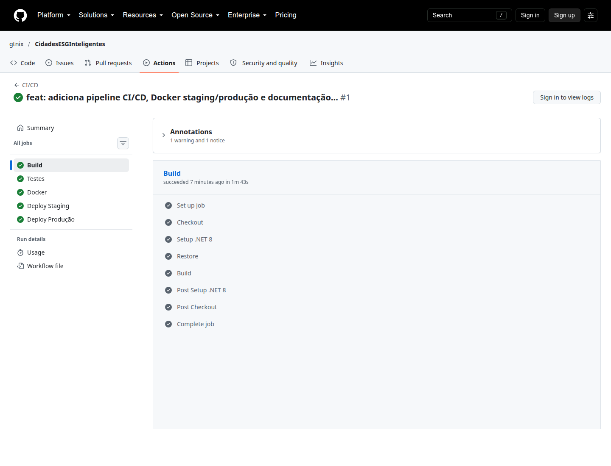
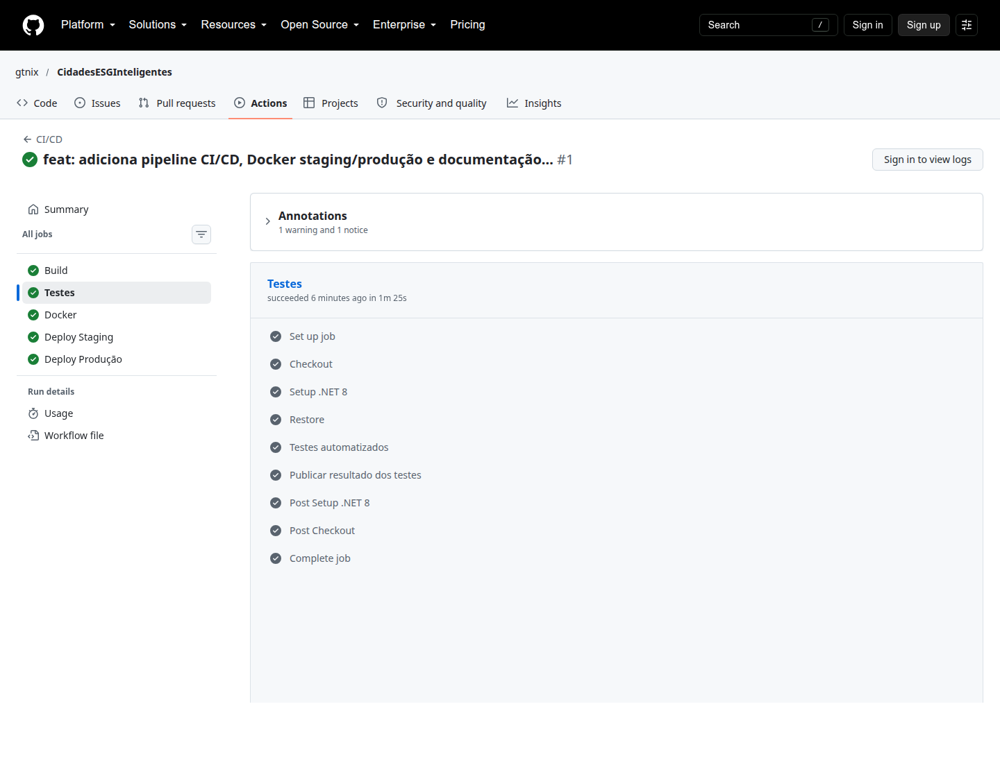
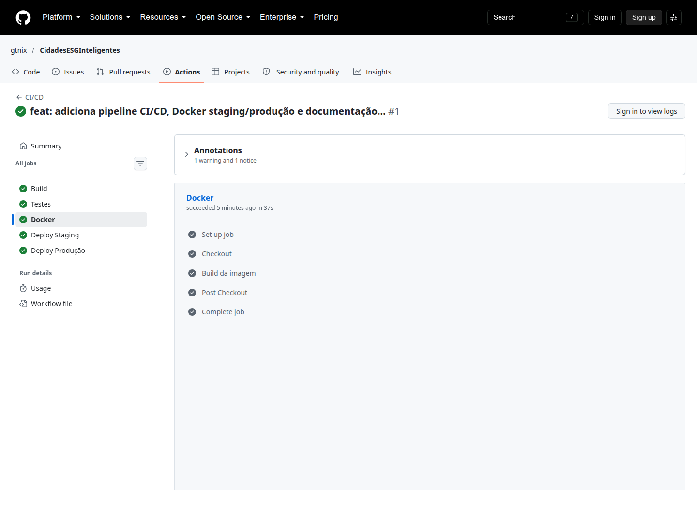
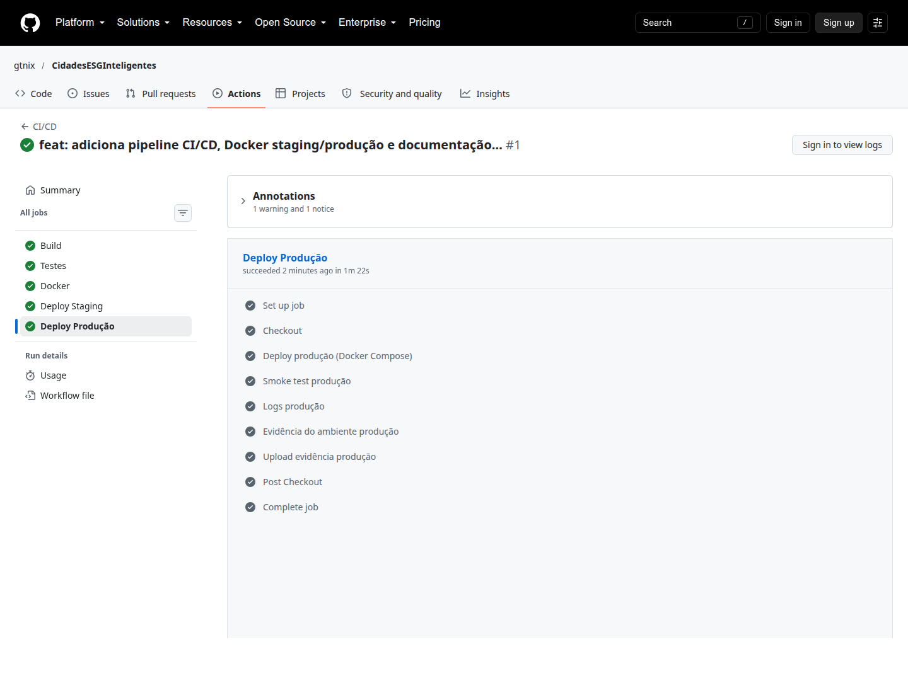
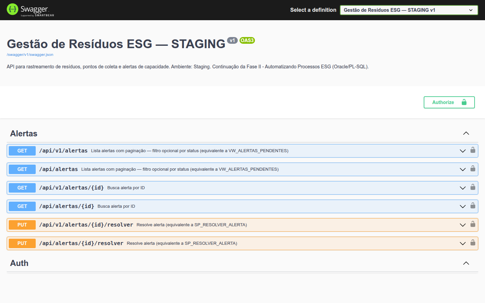
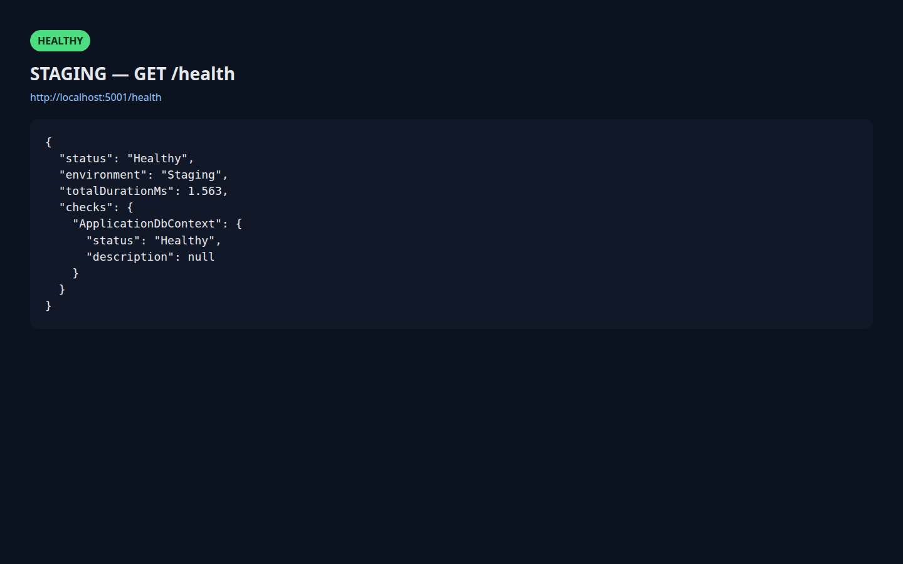
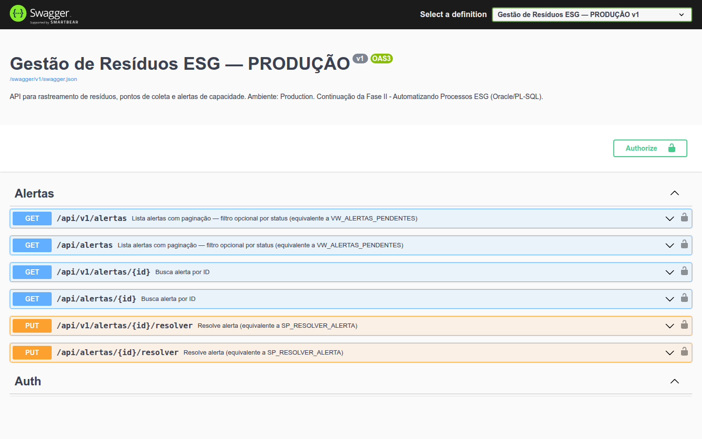
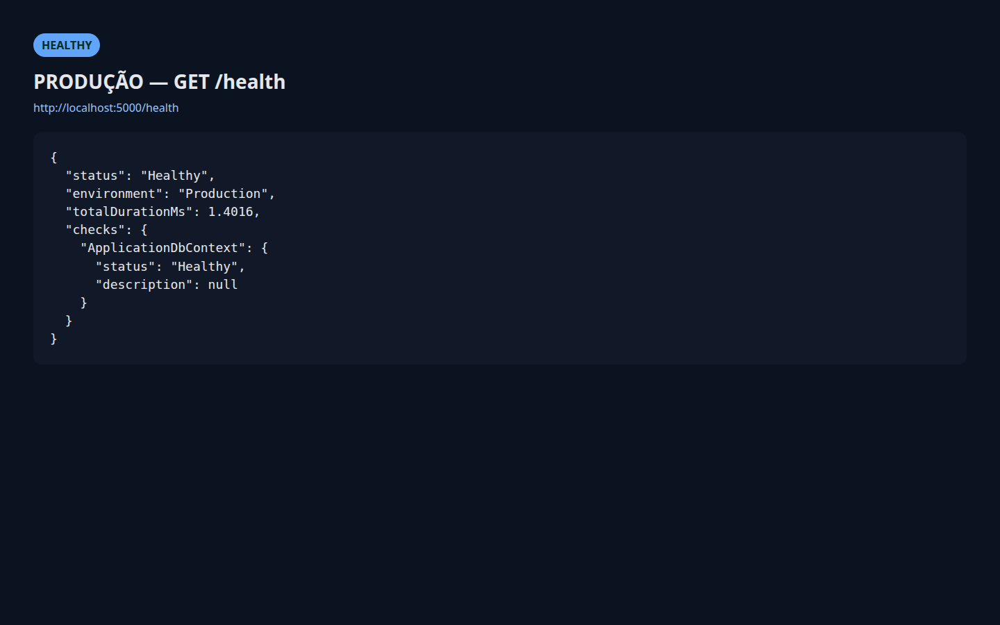
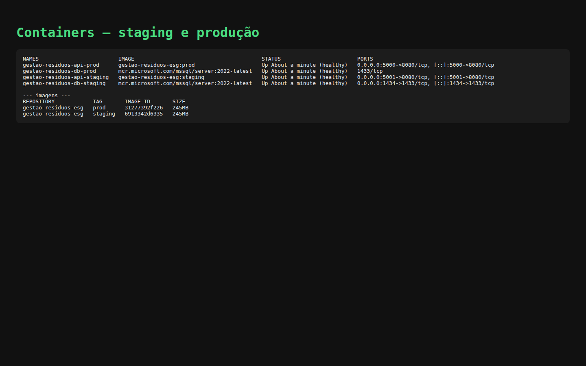

# Projeto - Cidades ESGInteligentes

## Documentação técnica — DevOps

**FIAP | Graduação em Análise e Desenvolvimento de Sistemas | Navegando pelo mundo DevOps**

### Integrantes

| Nome | RM |
| --- | --- |
| Andre Luiz Silva | RM565836 |
| Giuliana Takara | RM562736 |

Aplicação-base: API **Gestão de Resíduos ESG** (C# / ASP.NET Core 8), tema ESG, adaptada para simular staging e produção com Docker Compose e GitHub Actions.

---

## 1. Descrição do pipeline

**Ferramenta:** GitHub Actions.

**Arquivo:** `.github/workflows/ci-cd.yml`

**Gatilhos:** `push` e `pull_request` nas branches `main` e `develop`.

### Etapas e lógica

1. **Build** — `dotnet restore` e `dotnet build` em Release. Garante que a solução compila antes de qualquer outra etapa.
2. **Testes** — `dotnet test` executa os testes xUnit já existentes (~85 cenários: controllers e services). O job de testes só corre se o build passou. O arquivo TRX é publicado como artefato.
3. **Docker** — `docker build` da imagem multi-stage. Prova que o Dockerfile é funcional no mesmo runner da CI.
4. **Deploy Staging** — dispara em push para `develop` ou `main`, no GitHub Environment `staging`. Executa `./scripts/deploy.sh staging` (Compose com overlay de staging, porta 5001) e `./scripts/smoke-test.sh staging` (GET `/health` até `Healthy` + `environment=Staging`).
5. **Deploy Produção** — dispara somente em push para `main`, no GitHub Environment `production`, e **depende do staging ter passado**. Executa os mesmos scripts no overlay de produção (porta 5000).

Fluxo resumido:

```text
push/PR → Build → Testes → Docker → Deploy Staging → Deploy Produção
```

A produção nunca sobe se o staging falhar. Pull requests não fazem deploy, só build e testes.

Os scripts de deploy usados no Actions são os mesmos da máquina local, para o comportamento ser reproduzível na correção.

---

## 2. Docker — arquitetura, comandos e imagem

### Arquitetura

Dois stacks isolados (projetos Compose diferentes), cada um com API + SQL Server:

- **Staging:** projeto `gestao-esg-staging`, rede `gestao-esg-staging_esg-network`, volume próprio, API em `:5001`, SQL publicado em `:1434`, `ASPNETCORE_ENVIRONMENT=Staging`.
- **Produção:** projeto `gestao-esg-prod`, rede `gestao-esg-prod_esg-network`, volume próprio, API em `:5000`, **SQL Server não publicado**, `ASPNETCORE_ENVIRONMENT=Production`.

A API aplica migrations no startup. O `/health` consulta o `ApplicationDbContext` e devolve o nome do ambiente. O Swagger inclui `STAGING` ou `PRODUÇÃO` no título.

### Comandos usados

```bash
./scripts/deploy.sh staging
./scripts/smoke-test.sh staging
./scripts/deploy.sh production
./scripts/smoke-test.sh production

docker compose -p gestao-esg-staging -f docker-compose.yml -f docker-compose.staging.yml ps
docker compose -p gestao-esg-prod     -f docker-compose.yml -f docker-compose.prod.yml     ps
docker images | grep gestao-residuos-esg
```

### Imagem criada

Dockerfile multi-stage:

- Stage `build`: SDK 8.0, restore dos `.csproj` (cache), `dotnet publish` Release.
- Stage `runtime`: ASP.NET 8.0 + `curl` (healthcheck) + DLL publicada, porta 8080.

Tags locais geradas pelos overlays: `gestao-residuos-esg:staging` e `gestao-residuos-esg:prod`.

---

## 3. Prints do pipeline (build, testes, deploy)

Ver pasta `docs/evidencias/`:

- `pipeline-build.png`
- `pipeline-testes.png`
- `pipeline-docker.png`
- `pipeline-deploy-staging.png`
- `pipeline-deploy-production.png`










---

## 4. Prints dos ambientes staging e produção











---

## 5. Desafios encontrados e como foram resolvidos

1. **SQL Server não tem hospedagem gratuita estável sem cartão.** Staging e produção foram modelados como dois stacks Docker Compose isolados (redes, volumes e portas diferentes), o que atende o enunciado sem depender de crédito em nuvem.
2. **HTTPS redirect no container HTTP.** `UseHttpsRedirection` quebraria `/health` na porta 8080. A correção foi aplicar o redirect só em Development.
3. **Diferenciar staging de produção nos prints.** O título do Swagger e o JSON de `/health` passam a incluir o nome do ambiente.
4. **Compose local era v1 (1.29) sem `docker compose`.** Foi instalado o plugin Compose v2, o mesmo modelo do GitHub Actions.
5. **Healthcheck da API.** A imagem `aspnet:8.0` não traz `curl`; o pacote foi instalado no stage runtime.
6. **Segredos.** Connection string e JWT saíram de valores reais no `appsettings.json` (já estavam como placeholder). O `.env` fica fora do Git; a entrega inclui `.env.example`.
7. **SQL Server demora a ficar healthy.** `depends_on` com `service_healthy`, `--wait` no deploy e o smoke test com várias tentativas evitam falso negativo no pipeline.

---

## 6. Checklist de entrega (obrigatório)

| Item | OK |
| --- | --- |
| Projeto compactado em .ZIP com estrutura organizada | [x] |
| Dockerfile funcional | [x] |
| docker-compose.yml ou arquivos Kubernetes | [x] |
| Pipeline com etapas de build, teste e deploy | [x] |
| README.md com instruções e prints | [x] |
| Documentação técnica com evidências (PDF ou PPT) | [x] |
| Deploy realizado nos ambientes staging e produção | [x] |
